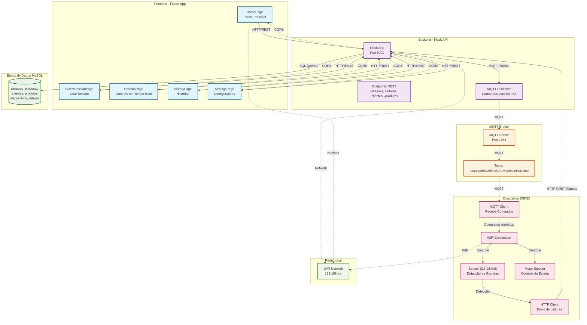

# Arquitetura da Aplicação de Contagem de Garrafas

## Diagrama da Arquitetura Completa



## Protocolos de Comunicação

### 1. HTTP/REST (Flutter ↔ Flask API)
- **Porta**: 5000
- **Endpoints**:
  - `GET /health` - Status da API
  - `GET /clientes` - Lista clientes
  - `GET /produtos` - Lista produtos
  - `GET /dispositivos` - Lista dispositivos
  - `POST /sessoes` - Criar sessão de produção
  - `POST /sessoes/{id}/finalizar` - Finalizar sessão
  - `GET /sessoes` - Listar sessões (paginado)
  - `POST /leituras` - Registrar leituras do sensor

### 2. MQTT (Flask API ↔ ESP32)
- **Porta**: 1883
- **Topic**: `factory/default/line/1/device/esteira1/cmd`
- **Comandos**:
  - `{"action": "start", "sessao_id": 123}` - Iniciar contagem
  - `{"action": "stop", "sessao_id": 123}` - Parar contagem

### 3. HTTP POST (ESP32 → Flask API)
- **Endpoint**: `POST /leituras`
- **Payload**:
  ```json
  {
    "sessao_id": 123,
    "device_code": "esteira1",
    "inc": 5,
    "ts": "2025-01-27T10:30:00Z"
  }
  ```

## Fluxo de Dados

### 1. Início de Sessão
1. **Flutter App** → `POST /sessoes` → **Flask API**
2. **Flask API** → Insere em `sessoes_producao` → **MySQL**
3. **Flask API** → `MQTT Publish` → **MQTT Broker**
4. **MQTT Broker** → `MQTT Message` → **ESP32**
5. **ESP32** → Liga motor e inicia contagem

### 2. Contagem em Tempo Real
1. **Sensor E18-D80NK** → Detecta garrafa → **ESP32**
2. **ESP32** → Incrementa contador
3. **ESP32** → `HTTP POST /leituras` → **Flask API**
4. **Flask API** → Insere em `leituras` → **MySQL**
5. **Flutter App** → `GET /sessoes/{id}` → **Flask API** → Atualiza UI

### 3. Finalização de Sessão
1. **Flutter App** → `POST /sessoes/{id}/finalizar` → **Flask API**
2. **Flask API** → Atualiza status → **MySQL**
3. **Flask API** → `MQTT Publish stop` → **MQTT Broker**
4. **ESP32** → Para motor e envia dados finais

## Componentes Técnicos

### Frontend (Flutter)
- **Framework**: Flutter/Dart
- **Estado**: SharedPreferences para configurações
- **HTTP**: http package para comunicação com API
- **UI**: Material Design 3

### Backend (Flask)
- **Framework**: Flask (Python)
- **CORS**: Habilitado para todas as origens
- **Database**: MySQL via SQLAlchemy
- **MQTT**: paho-mqtt para comunicação com ESP32

### Dispositivo IoT (ESP32)
- **Microcontrolador**: ESP32
- **Sensor**: E18-D80NK (infravermelho)
- **Motor**: Stepper motor com driver
- **Comunicação**: WiFi + HTTP + MQTT
- **Linguagem**: Arduino C++

### Banco de Dados
- **Tabelas principais**:
  - `sessoes_producao` - Sessões de produção
  - `leituras` - Leituras do sensor
  - `clientes` - Clientes
  - `produtos` - Produtos
  - `dispositivos` - Dispositivos IoT

## Configurações de Rede

### Endereços IP (Exemplo)
- **Flask API**: `192.168.0.104:5000`
- **MQTT Broker**: `172.16.3.108:1883`
- **ESP32**: DHCP na rede WiFi

### WiFi
- **SSID**: "Espaço Cria"
- **Password**: "@@EspacoCria2025@@"

## Segurança e Confiabilidade

### Tratamento de Erros
- Timeout de 8 segundos para requisições HTTP
- Reconexão automática MQTT
- Validação de dados em todas as camadas
- Logs detalhados para debugging

### Persistência
- Dados salvos em MySQL
- Configurações em SharedPreferences (Flutter)
- Buffer de leituras no ESP32 (envio em lote)

### Monitoramento
- Health check endpoint
- Status de conexão API
- Logs de MQTT e HTTP
- Indicadores visuais na UI
