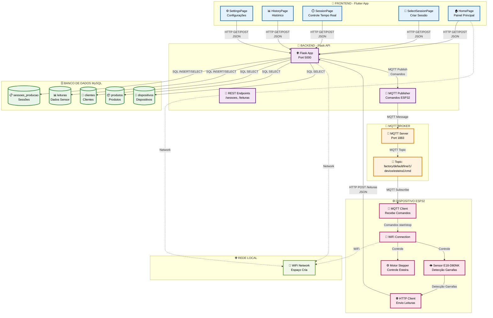

# 🏭 Sistema de Contagem de Garrafas - Diagrama Visual

## Para visualizar como imagem, use um dos seguintes métodos:

### 1. **Mermaid Live Editor** (Recomendado)
Acesse: https://mermaid.live/
Cole o código abaixo:

### 2. **Draw.io / Diagrams.net**
Acesse: https://app.diagrams.net/
Use os componentes:
- Retângulos para componentes
- Círculos para banco de dados
- Setas para fluxo de dados
- Cores diferentes para cada camada

### 3. **Lucidchart**
Acesse: https://lucidchart.com/
Crie um diagrama de arquitetura com:
- Componentes de frontend (azul)
- Backend (roxo)
- Banco de dados (verde)
- MQTT (laranja)
- Dispositivos (rosa)

## 🎨 Cores Sugeridas:
- **Frontend**: Azul (#e3f2fd)
- **Backend**: Roxo (#f3e5f5)
- **Banco de Dados**: Verde (#e8f5e8)
- **MQTT**: Laranja (#fff3e0)
- **Dispositivos**: Rosa (#fce4ec)
- **Rede**: Verde claro (#f1f8e9)

## 📋 Componentes para Incluir:

### Frontend (Flutter)
- HomePage
- SelectSessionPage
- SessionPage
- HistoryPage
- SettingsPage

### Backend (Flask)
- Flask App
- REST Endpoints
- MQTT Publisher

### Banco de Dados
- sessoes_producao
- leituras
- clientes
- produtos
- dispositivos

### MQTT
- MQTT Server
- Topics

### Dispositivo ESP32
- WiFi Connection
- Sensor E18-D80NK
- Motor Stepper
- HTTP Client
- MQTT Client

### Rede
- WiFi Network

## 🔄 Fluxos de Dados:
1. **HTTP/REST**: Flutter ↔ Flask API
2. **SQL**: Flask API ↔ MySQL
3. **MQTT**: Flask API ↔ ESP32
4. **HTTP POST**: ESP32 → Flask API
5. **WiFi**: Rede local
